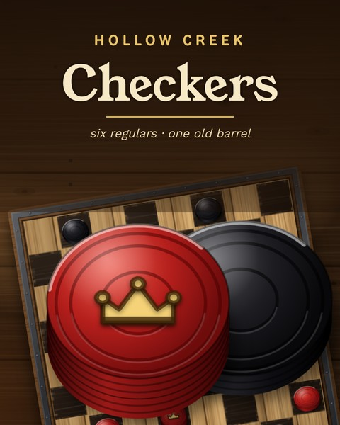

# Checkers: Hollow Creek General Store

An Ironite game. American checkers in an old country store, against six regulars or a friend.



- **Full American checkers rules:** forced captures (or optional ones, as a house rule), multi-jumps, crowning that ends the move, and kings that move both ways. Draws come from threefold repetition, the forty-move rule or agreement.
- **Six computer opponents,** from Little Tucker (just learning) to Old Gus (county champion). The engine is alpha-beta search running in a Web Worker.
- **HD art drawn in code at any resolution:** three boards (Barrelhead, Parlor Red, Tournament Green) and three piece sets (Red & Black, Walnut & Maple, Bottle Caps).
- **Original music and sounds:** four old-time tunes and all sound effects are synthesized live with Web Audio.
- **Saves:** your unfinished game, record and settings live in `%APPDATA%\Ironite\Checkers`.

## Layout

```
web/          The game: index.html, checkers.js (rules), ai.js (engine), art.js, music.js, game.js
              core.js + base.css are shared with the other Ironite games
app/          Go shell: serves web/ and opens it in an Edge app window, handles saves
tools/        perft.js, aitest.js, art/cover/icon render pages, mkres (exe icon + version, deps vendored)
assets/       icon-1024.png, launcher cover and banner art
package/      README.txt and CREDITS.txt that ship with the game
installer/    Inno Setup script (CheckersSetup.iss + shared template) and wizard art
```

## Build

Needs Go 1.24 or newer. Runs on Linux, macOS or WSL and works offline.

```
./build.sh
```

That produces:

- `dist/Checkers/Checkers.exe`, the Windows game
- `dist/Checkers-Installer-v1.0.0/`: copy this folder to Windows and double-click **Build Installer.bat**. It uses Inno Setup 6.3 or newer and offers to install it with winget if it's missing. The setup appears in `Output\Checkers-Setup-v1.0.0.exe`.

The setup installs into the Ironite folder (`Program Files\Ironite\Games\Checkers`), next to Ironite Launcher if that's installed.

To play without building, open `web/` through any local web server (e.g. `python3 -m http.server` in `web/`). Saves then fall back to browser storage.

## Test

```
node tools/perft.js     # move generation vs. the published counts, depth 1-8
node tools/aitest.js    # the opponents play each other; stronger should beat weaker
```

## Releasing

Add a `## [x.y.z]` entry to `web/CHANGELOG.md`. Also set `VERSION` in `web/game.js` and `GameVersion` in `installer/CheckersSetup.iss` to match (build.sh checks the installer).

(c) 2026 Ironite. Fonts: National Park, Young Serif, Work Sans (SIL Open Font License, `web/fonts/OFL.txt`).
