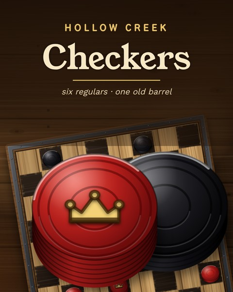

# Checkers: Hollow Creek General Store

American checkers in an old country store, by Ironite. Written in Go with
[Ebitengine](https://ebitengine.org). Play six regulars from beginner to
county champion, share one computer with a friend, or play together online.
It ships on its own and inside the Ironite Launcher.



## How to play

- **Rules:** full American checkers. Captures are compulsory (or optional, as a house rule), multi-jumps are taken in full, a man that reaches the far row is crowned and his move ends, and kings move both ways. You lose with no pieces or no move. Draws come from threefold repetition, the forty-move rule or agreement.
- **Moving:** click a piece and then a square, or drag it. Take multi-jumps one landing at a time or click the last square. Pieces that must jump glow gold.
- **Tools:** undo, hint, flip board, offer a draw, resign, and a score sheet in standard 1–32 notation that steps back through the game and copies it as text.
- **Keys:** `Ctrl+Z` undo, `H` hint, `F` flip, `N` new game, `M` music, `←`/`→` step through the moves, `Esc` cancels a jump, `F11` full screen.

### Ways to play

- **Play the Computer:** the six regulars are the six levels: Little Tucker, Miss Opal, Deacon Earl, Hattie Mae, Doc Whitfield and Old Gus. Each keeps their face and style but gets a fresh name each game, always one that fits them (Miss Opal might be Miss Pearl or Miss Edna). Your record is kept per level.
- **Same Computer:** two people share one PC, each with their own name and face. The board turns to face whoever's moving.
- **Online:** one player hosts and a friend joins by IP address (TCP port 47020). The host's game picks the colours and the rules, and referees every move. Players can offer draws, resign and ask for rematches (the colours swap). If one leaves mid-game, the other can finish against the computer.

Saves and settings are in `%APPDATA%\Ironite\Checkers\save.json` (the same
file and format as 1.0.0, so existing saves carry over), outside the install
folder. Online games aren't saved.

## Code

| File | What it is |
|---|---|
| `main.go` | Window setup, the frame loop, mouse, keys and text fields. |
| `game.go` | The game: turns, moves and jumps, the computer opponent, undo, hints, draws, review, the record. |
| `net.go` | Online play: host/guest protocol (JSON lines over TCP). |
| `engine.go`, `ai.go` | Rules (perft-verified) and the computer player: alpha-beta with iterative deepening, a transposition table and six levels. |
| `ui.go` | Toolbar, side panel, score sheet, title screen and every dialog. |
| `board.go`, `fx.go` | The board drawn each frame: pieces, highlights, rings, dots, the hint arrow, move animation, confetti, bubbles and banners. |
| `gfx.go`, `text.go` | The 2D painter (gradients, rounded shapes, shadows, text) used for the panels, at the window's real resolution. |
| `synth.go`, `music.go`, `audio.go` | The synthesizer that plays the four tunes and the sound effects live. |
| `data.go`, `save.go`, `assets.go` | The regulars and their names, piece sets and boards; the save file; embedded assets. |
| `assets/` | Boards, pieces, portraits, the store scene, fonts, icon and launcher art. |
| `tools/mkres/` | Writes the Windows icon and version info into the .exe. |
| `installer/` | Inno Setup scripts for the standalone `Checkers-Setup-v<version>.exe`. |

## Tests

The tests use the `headless` build tag, which builds the game with no window
or sound:

```bash
go test -tags headless .
```

- `engine_test.go`: move generation against the published perft counts (depth 1–8), multi-jumps and crowning, and the computer levels.
- `net_test.go`: a host and a guest over real TCP. It plays whole games and checks both boards stay identical, plus rematches, a draw offer, a bad move from the guest being corrected, the guest leaving (the computer takes over) and a third player being turned away.
- `perf_test.go`: how long a repaint of the panels takes at 1080p, 1440p and 4K.

`testhooks_js.go` and `save_js.go` are for the browser build (`GOOS=js GOARCH=wasm`) used for automated screenshots.

## Building

You need Go 1.24 or newer and bash (Git Bash works on Windows). No C compiler
is needed.

```bash
./build.sh
```

That writes `dist/Games/Checkers/` with `Checkers.exe`, README, credits,
changelog and the font licence. To make the installer, run
`ISCC.exe installer/CheckersSetup.iss` (Inno Setup 6.3+).

## Releasing

Add a `## [x.y.z]` section to `CHANGELOG.md`, set `Version` in `game.go` and
`GameVersion` in `installer/CheckersSetup.iss` to match (build.sh checks),
and push to `main`. The release workflow builds the game and publishes
`Checkers-<version>-windows.zip` as release `v<version>`. Ironite Launcher
installs and updates Checkers from there.

(c) 2026 Ironite. Fonts: National Park, Young Serif, Work Sans (SIL Open Font License, `assets/fonts/OFL.txt`).
